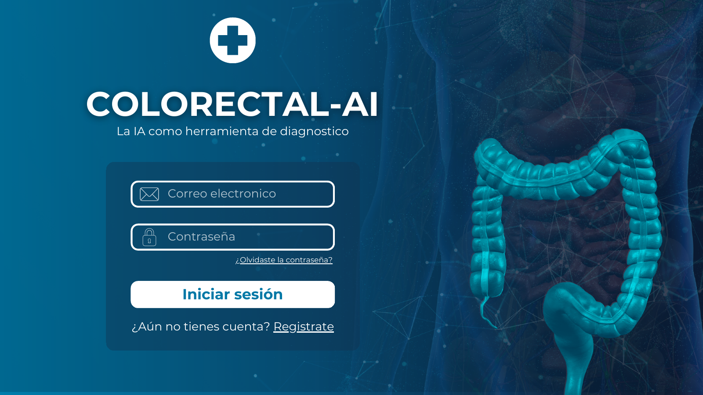
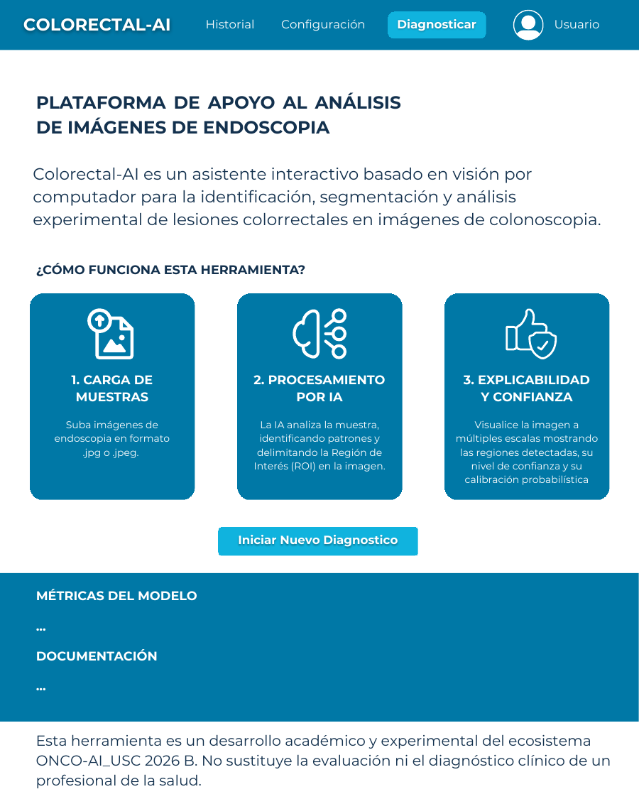
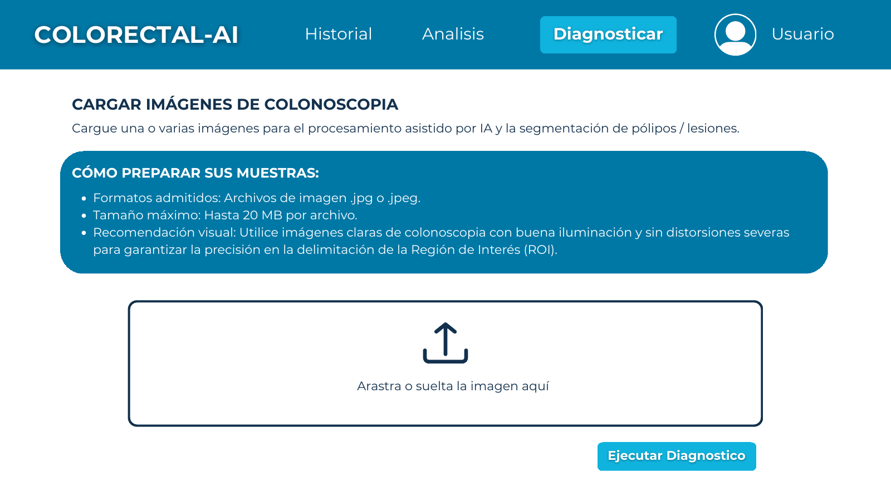
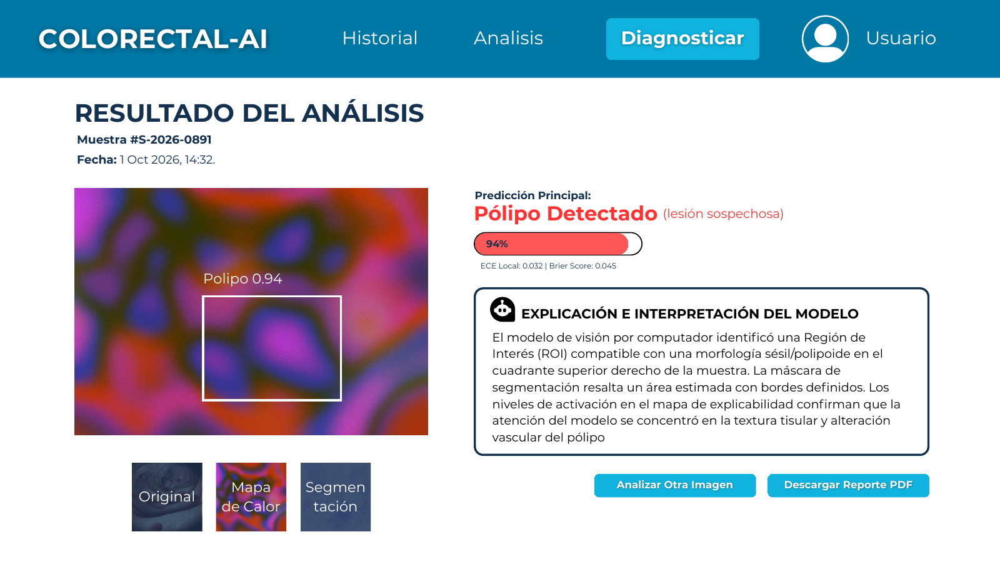

# Mockups de la interfaz


**Estado: Terminado** · Versión: **01-10-2026** · Responsable: Juan Stevan Loza (Diseñador)


Prototipos de la interfaz web de ColorrectalAI (versión del 01-10-2026). Se revisan contra RF-005.1, RF-005.2, RF-006 y RF-007, y RNF-014.1, RNF-015.1, RNF-015.2 y RNF-016.1 (hito 014).

## Inicio de sesión

## Página principal

Presenta la plataforma y explica el flujo en tres pasos: **carga de muestras → procesamiento por IA → explicabilidad y confianza**. Incluye acceso a las métricas del modelo y a la documentación, y el aviso de uso académico y experimental.

## Carga de imágenes

Permite arrastrar o seleccionar imágenes de colonoscopia e indica cómo preparar las muestras (formatos admitidos, tamaño máximo y recomendaciones de calidad visual).


Los mockups indican archivos .jpg/.jpeg de hasta 20 MB, mientras que el requisito RNF-015.2 fija JPEG/PNG ≤ 10 MB. La implementación debe seguir el requisito.


## Resultado del análisis

Muestra la predicción principal con su nivel de confianza, las métricas de calibración (ECE y Brier Score), una explicación textual y tres vistas de la imagen: **original, mapa de calor y segmentación**. Permite analizar otra imagen o descargar el reporte en PDF.

