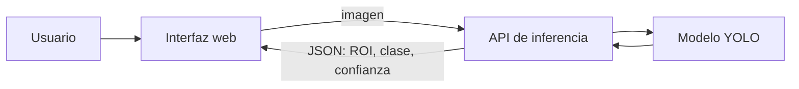

# Integración


**Estado: Pendiente** · Entregable **E04** (hito 018, 19 nov 2026 \*) · Sistema integrado (hito 020, 22 nov 2026 \*)


## Arquitectura de alto nivel

| Componente | Responsabilidad |
| --- | --- |
| **Modelo baseline YOLO** | Detecta/segmenta la región de interés y produce clase y confianza. |
| **API de inferencia** | Recibe una imagen (JPEG/PNG ≤ 10 MB), ejecuta la inferencia y devuelve en JSON la ROI, la clasificación experimental, la confianza y la versión del modelo. No guarda imágenes. |
| **Interfaz web** | Carga la imagen y muestra ROI, clasificación y confianza, con el aviso de uso experimental en todas las vistas. |

## Verificación

**API (hito 018):**

* [ ] Latencia p95 ≤ 5 s (RNF-013.1)
* [ ] Al menos 5 usuarios concurrentes sin superar ese umbral (RNF-013.2)
* [ ] Archivos inválidos rechazados con 4xx (RNF-015.2)
* [ ] Sin almacenamiento persistente de imágenes (RNF-015.1)
* [ ] Health check en OK

**Sistema integrado (hito 020):**

* [ ] Prueba de extremo a extremo exitosa ejecutada por QA
* [ ] Levantamiento con Docker siguiendo solo el README
