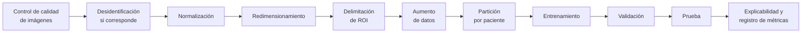

# Metodología y pipeline de IA

## Gestión del proyecto

La gestión sigue la guía **PMBOK** (usada en el curso) con la metodología **PM²** adaptada al contexto académico, cubriendo inicio, planificación, ejecución, monitoreo y control, y cierre: alcance, actividades, responsables, entregables, riesgos y mecanismos de seguimiento.

## Desarrollo del software

El producto se desarrolla con **Team Software Process (TSP)**, alineado con el ciclo de vida del curso: requerimientos, diseño, construcción, pruebas, control de versiones y documentación. Ver [Monitoreo y control con TSP](../monitoreo/tsp.md).

## Pipeline de inteligencia artificial

## Arquitectura de alto nivel

El módulo se compone de tres piezas integradas a ONCO-AI_USC 2026 B:

| Componente | Responsabilidad |
| --- | --- |
| **Modelo baseline YOLO** | Detecta/segmenta la región de interés y produce clase y confianza. |
| **API de inferencia** | Recibe una imagen (JPEG/PNG ≤ 10 MB), ejecuta la inferencia y devuelve en JSON la ROI, la clasificación experimental, la confianza y la versión del modelo. No almacena imágenes de forma persistente. |
| **Interfaz web** | Permite cargar la imagen y visualizar la ROI, la clasificación y la confianza, con el aviso de uso experimental en todas las vistas. |

## Fases técnicas

| Fase | Contenido | Hitos |
| --- | --- | --- |
| 1. Análisis y arquitectura | Problema, requerimientos, backlog, arquitectura y dataset | 012–013 |
| 2. Diseño | Diseño de API, frontend y baseline del modelo | 014–015 |
| 3. Construcción e integración | Modelo, integración con backend y frontend, experimentación | 016–020 |
| 4. Validación final | Pruebas, métricas, resultados, documentación y demostración | 021–025 |

## Gestión de datos

* **Dataset:** PolypGen, descargado de Synapse, licencia **CC BY 4.0** (cita: Ali et al., 2023).
* La partición se hace **por paciente** cuando la estructura de los datos lo permite, evitando que imágenes del mismo paciente aparezcan en entrenamiento y prueba.
* Cada conjunto documenta procedencia, licencia, población, modalidad, etiquetas, versión, criterios de inclusión/exclusión y posibles sesgos.

## Control de versiones y reproducibilidad

* Repositorio Git con ramas, pull requests y versiones etiquetadas.
* Se conservan README, configuración del entorno, notebooks o scripts de entrenamiento, registros de experimentos y parámetros de los modelos.
* Semillas fijas y versiones de dependencias y datos registradas (RNF-018.1).
* Objetivo: que otra persona del equipo pueda reconstruir el experimento solo con la documentación.

## Ética y delimitación


Todos los resultados se presentan como **experimentales**. El sistema no emite diagnósticos médicos ni recomendaciones terapéuticas. La interfaz incluye una advertencia visible indicando que el resultado corresponde a un experimento académico y no constituye diagnóstico.

