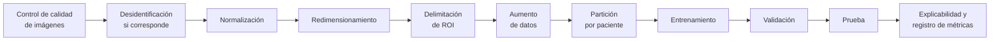

# Modelo IA


**Estado: Pendiente** · Entregables **E02** (hito 016, 8 nov 2026 \*) y **E03** (hito 017, 15 nov 2026 \*)


## Pipeline de inteligencia artificial

## Modelo baseline

Modelo de detección/segmentación basado en **YOLO** que produce la región de interés, la clasificación experimental y la confianza. Incluye mapa de explicabilidad (RF-006) y calibración con Brier Score y/o ECE (RF-007).

## Umbrales de evaluación (hito 015)

Se aprueban **antes** del primer entrenamiento evaluado (RNF-021.1). Metas del [Plan de calidad](../planeacion/plan-calidad.md): sensibilidad ≥ 0,80, F1 ≥ 0,75, mAP@0.5 ≥ 0,60, ECE ≤ 0,10, entre otras.

## Reproducibilidad

* Semillas fijas, versiones de dependencias y datos registradas (RNF-018.1).
* Configuración, scripts o notebooks y registro de experimentos versionados.
* Otro integrante debe reproducir el pipeline desde un clonado limpio (hito 016) con una diferencia de mAP@0.5 ≤ 0,02.

## Resultados del entrenamiento

*Se publicarán cuando el modelo esté entrenado.*
