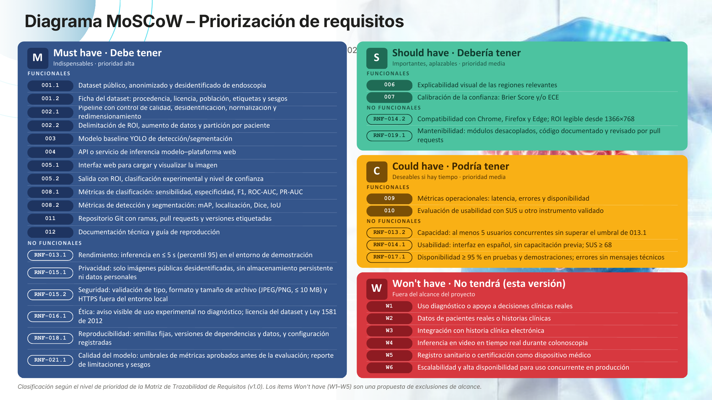

# Diagrama MoSCoW


**Estado: Terminado** · Versión: **v2** · Cargado en Trello: 18 oct 2026 · Responsable: System Force



📄 El documento completo se puede leer dentro de esta página, sin descargarlo, en [Documento completo](#documento-completo).


Los requisitos se priorizaron con la técnica **MoSCoW** a partir del nivel de prioridad de la Matriz de Trazabilidad de Requisitos (v1.0).



**Indispensables · prioridad alta**

Funcionales: 001.1, 001.2, 002.1, 002.2, 003, 004, 005.1, 005.2, 008.1, 008.2, 011, 012.

No funcionales: RNF-013.1 (rendimiento), RNF-015.1 (privacidad), RNF-015.2 (seguridad), RNF-016.1 (ética), RNF-018.1 (reproducibilidad), RNF-021.1 (calidad del modelo).



**Importantes, aplazables · prioridad media**

* 006 — Explicabilidad visual de las regiones relevantes
* 007 — Calibración de la confianza: Brier Score y/o ECE
* RNF-014.2 — Compatibilidad con Chrome, Firefox y Edge; ROI legible desde 1366×768
* RNF-019.1 — Mantenibilidad: módulos desacoplados, código documentado y revisado por pull requests



**Deseables si hay tiempo**

* 009 — Métricas operacionales: latencia, errores y disponibilidad
* 010 — Evaluación de usabilidad con SUS
* RNF-013.2 — Al menos 5 usuarios concurrentes
* RNF-014.1 — Interfaz en español, SUS ≥ 68
* RNF-017.1 — Disponibilidad ≥ 95 %



**Fuera del alcance de esta versión**

* W1 — Uso diagnóstico o apoyo a decisiones clínicas reales
* W2 — Datos de pacientes reales o historias clínicas
* W3 — Integración con historia clínica electrónica
* W4 — Inferencia en video en tiempo real durante colonoscopia
* W5 — Registro sanitario o certificación como dispositivo médico
* W6 — Escalabilidad y alta disponibilidad para uso concurrente en producción



## Documento completo


