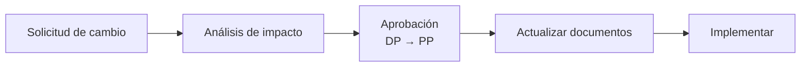

# Plan de alcance


**Estado: Terminado** · ID: **C-03** · Hito 005 · Entregado: **11 oct 2026** · Responsable: Edwin Cabezas



📄 El documento completo se puede leer dentro de esta página, sin descargarlo, en [Documento completo](#documento-completo).


Define qué incluye y qué no incluye ColorrectalAI y cómo se controlan los cambios. El documento completo (*Plan de Gestión del Alcance ColorrectalAI*) está adjunto en Trello, lista **Planeación**. Sus anexos son la [Matriz de trazabilidad](../trazabilidad/matriz-trazabilidad.md) (1.1) y la [EDT/WBS](edt.md) (1.2).

## Dentro del alcance

* Recepción y procesamiento de imágenes de colonoscopia.
* Modelo de IA para la detección de posibles pólipos (baseline YOLO).
* Indicación visual de la zona detectada (ROI), con clasificación experimental y confianza.
* Presentación y registro de resultados en una interfaz gráfica.
* Pruebas y evaluación del modelo y del sistema.

## Fuera del alcance

* Diagnóstico médico definitivo o sustituir al médico.
* Realizar colonoscopias o prescribir tratamientos.
* Implementación clínica real en hospitales.
* Uso de datos de pacientes reales o historias clínicas.

Ver también los ítems *Won't have* del [Diagrama MoSCoW](moscow.md) y el alcance del [Acta de inicio](../inicio/acta-inicio.md).

## Control formal de cambios

Todo cambio queda en el **Registro de cambios** del libro TSP. Ejemplo: **SC-01**, unificar el umbral de latencia entre la ERS (p95 ≤ 5 s) y el Plan de Calidad (≤ 2 s).

## Documento completo


