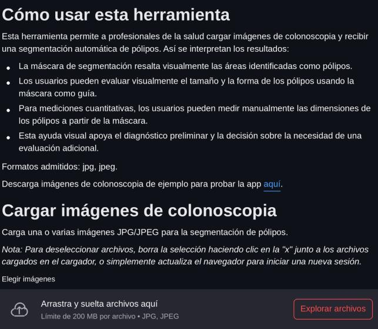
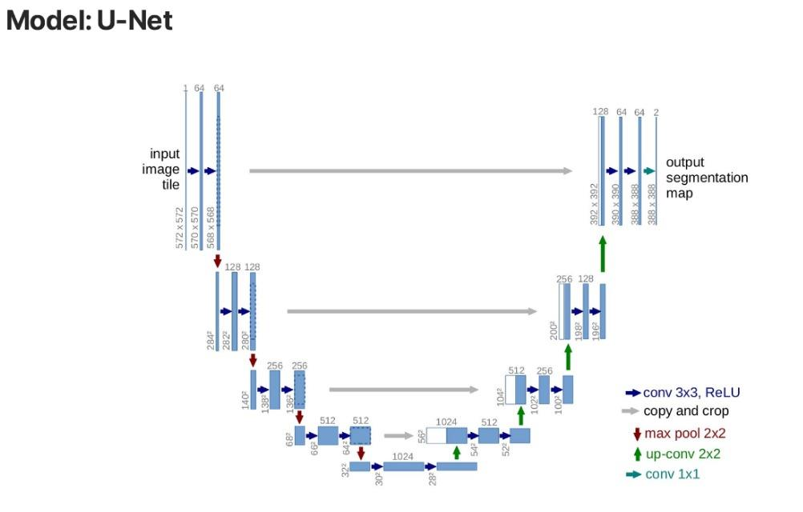
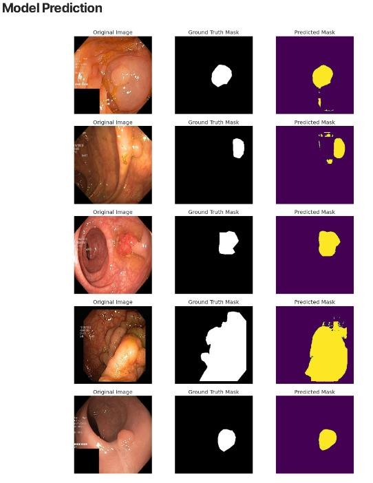
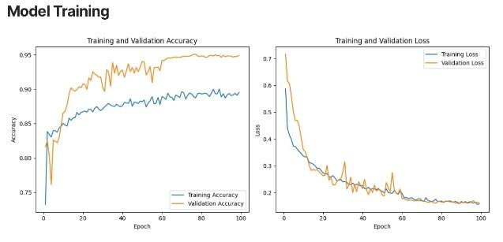

# Antecedentes

Los antecedentes de ColorrectalAI se agrupan en antecedentes científicos sobre IA aplicada a colonoscopia, antecedentes tecnológicos y antecedentes metodológicos relacionados con IA médica responsable.

## IA aplicada a colonoscopia

**Lou et al. (2023)** — Revisión sistemática y metaanálisis de ensayos clínicos aleatorizados sobre IA para detección de neoplasias colorrectales durante colonoscopia. Incluyó 33 ensayos y 27.404 pacientes y encontró una reducción significativa en las tasas de lesiones omitidas con asistencia de IA. Evidencia el interés científico en usar IA como apoyo a la detección endoscópica.

**Barua et al. (2021)** — Revisión sistemática y metaanálisis de sistemas de IA para detección de pólipos. Encontraron mayor detección de adenomas pequeños y pólipos, pero no una diferencia equivalente para adenomas avanzados. Demuestra que el desempeño de la IA depende del tipo de lesión y no debe resumirse en una única medida de exactitud.

**Hassan et al. (2023)** — Revisión sistemática y metaanálisis de beneficios y posibles daños de CADe para neoplasia colorrectal. Señala el incremento de la detección y la reducción de lesiones omitidas, pero advierte sobre sobrediagnóstico y tratamiento innecesario. Respalda tratar ColorrectalAI como un artefacto experimental que reporte tanto desempeño como limitaciones.

## Antecedentes tecnológicos

**Polyp Segmentation Tool** es un proyecto de código abierto orientado a la segmentación de pólipos en imágenes de colonoscopia. Usa el dataset **Kvasir-SEG** y un modelo basado en **U-Net** implementado con TensorFlow, e incorpora una aplicación web en **Streamlit** desde la cual el usuario carga imágenes, las procesa con el modelo y visualiza las máscaras de segmentación.

Su arquitectura sigue las etapas de preparación y preprocesamiento de imágenes, procesamiento mediante U-Net y presentación de resultados en la interfaz web. Permite procesar varias imágenes y descargar las máscaras; el modelo entrenado se almacena externamente y se carga cuando es necesario.

Este proyecto es relevante para ColorrectalAI porque demuestra una forma concreta de integrar un modelo de segmentación de imágenes médicas con una interfaz de usuario.

## Antecedentes metodológicos

| Guía | Autores | Aporte a ColorrectalAI |
| --- | --- | --- |
| **CLAIM** — Checklist for AI in Medical Imaging | Mongan, Moy y Kahn (2020) | Estructurar la documentación con calidad y transparencia, evitando reportar una métrica aislada. |
| **DECIDE-AI** | Vasey et al. (2022) | Aunque el sistema no es clínico, resalta la importancia de evaluar el comportamiento del sistema y la interacción con el usuario. |
| **FUTURE-AI** | Lekadir et al. (2025) | Consenso internacional sobre IA confiable en salud: equidad, robustez, trazabilidad y gobernanza. |
